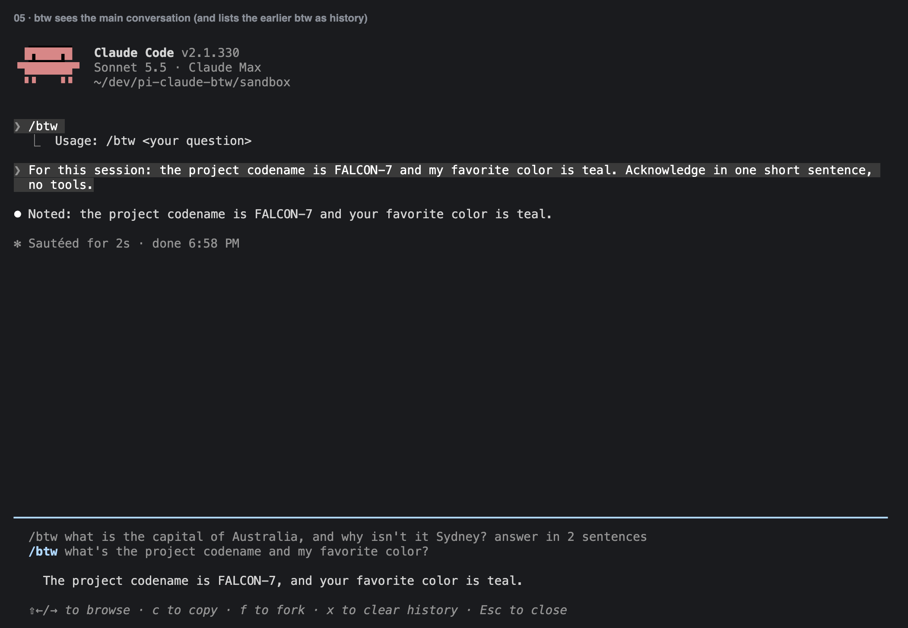
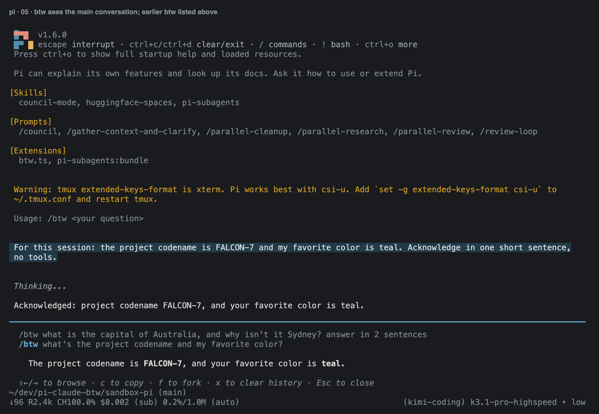
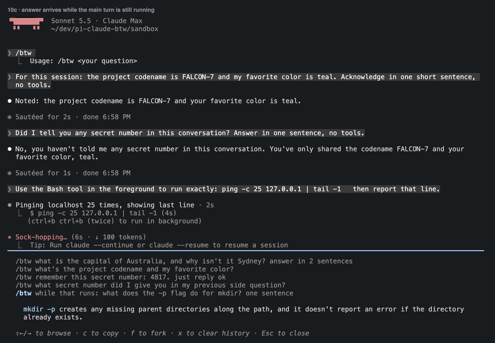
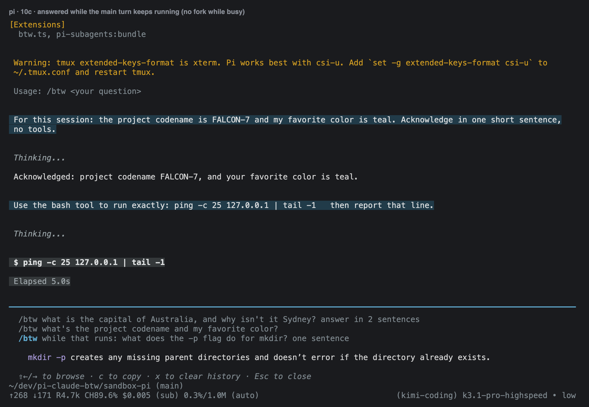
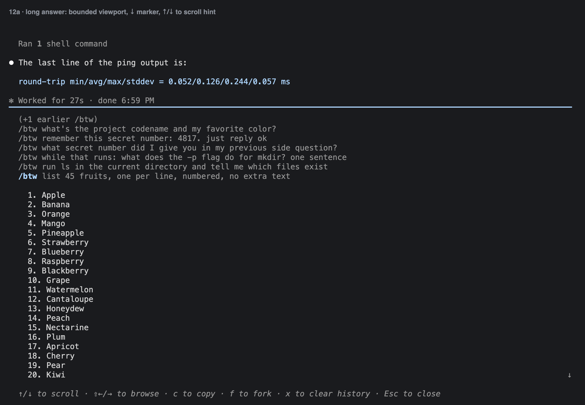
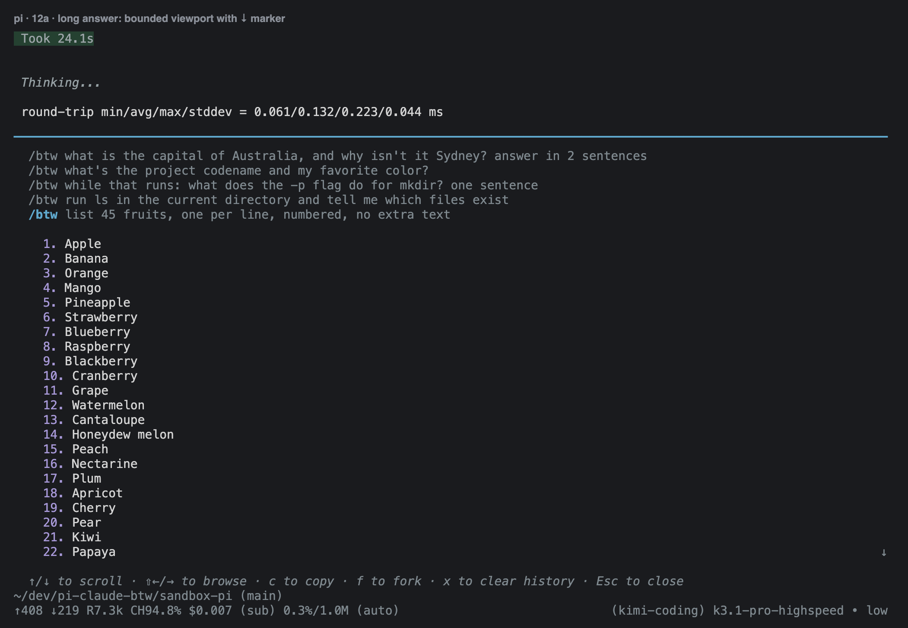
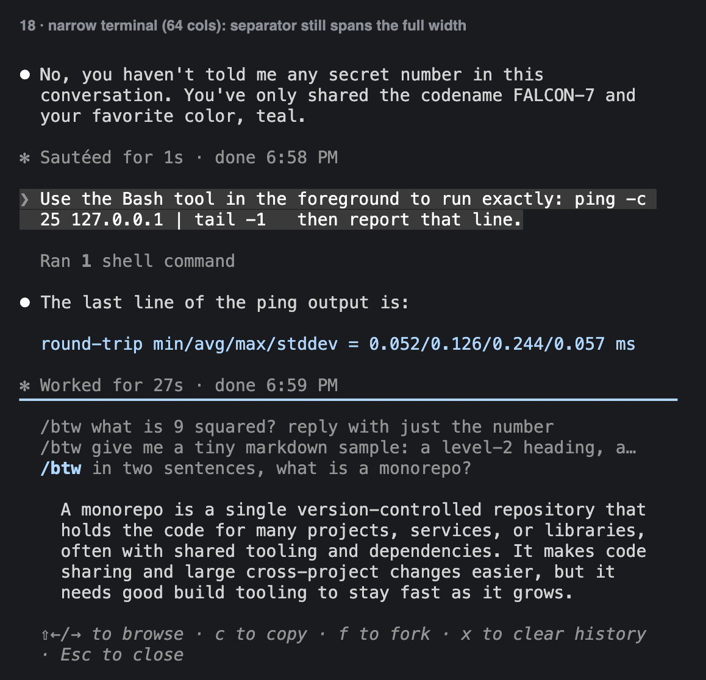
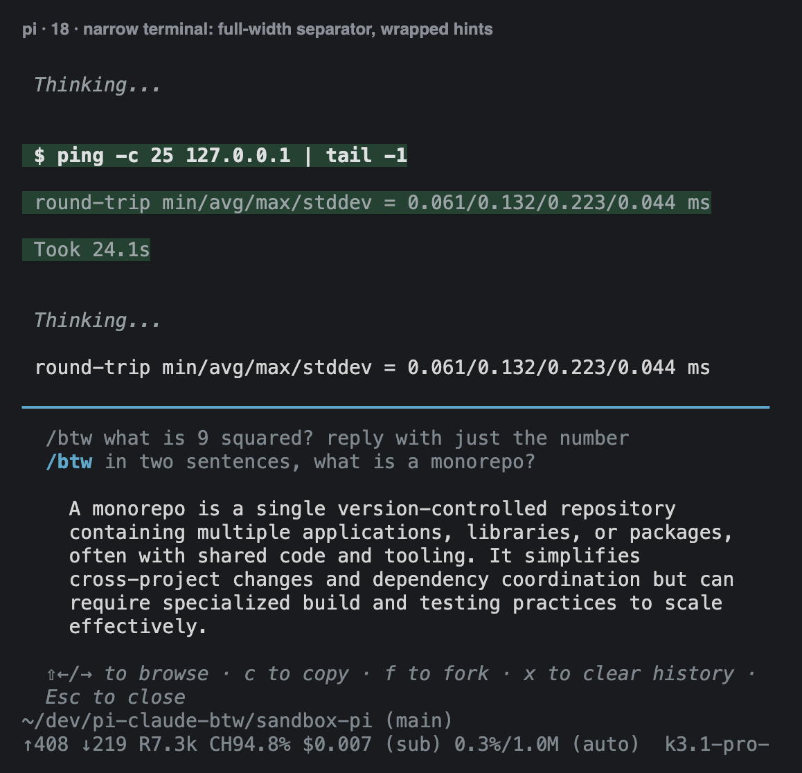

# pi-claude-btw

[](https://github.com/meshkati/pi-claude-btw/actions/workflows/ci.yml) [](https://www.npmjs.com/package/@meshkati/pi-claude-btw)

`/btw` for [pi](https://pi.dev): ask a quick side question while the agent keeps working. It is a port of Claude Code's `/btw` that matches its layout, keys, history, and prompt.

```
/btw what does the -p flag do for mkdir?
```

The answer opens in a panel that takes the editor's place, under a full-width `▔` separator. It is built from the conversation so far, uses no tools, and is never written to the session. The main agent is not interrupted.

## Install

```bash
pi install npm:@meshkati/pi-claude-btw           # from npm
pi install git:github.com/meshkati/pi-claude-btw  # or straight from GitHub
pi -e ./extensions/btw.ts                        # or try it once from a clone, without installing
```

It is one file, [`extensions/btw.ts`](extensions/btw.ts), with no dependencies beyond pi itself.

## Use

| | |
|---|---|
| `/btw <question>` | Ask. Works while the agent is idle or mid-turn. |
| `/btw` | Reopen the last answer. If there is none, shows the usage line. |
| Esc, Enter, Space, Ctrl+C, Ctrl+D | Close the panel. A question still loading is cancelled. |
| ↑ ↓ (Ctrl+P, Ctrl+N), PgUp, PgDn, Home, End | Scroll a long answer |
| Shift+← Shift+→, `[` `]`, Tab, Shift+Tab | Browse earlier side questions |
| `c` | Copy the answer |
| `x` | Clear earlier side questions |
| `f` | Fork: continue this side question in a new session, with tools |

## How it matches Claude Code

[`references/`](references/README.md) holds 31 captures of Claude Code's `/btw` in 20 scenarios, plus the behaviour spec drawn from them. [`screenshots/pi/`](screenshots/pi) shows the same scenarios run through this extension, with matching numbers.

| Claude Code (`references/`) | pi (`screenshots/pi/`) |
|---|---|
|  |  |
|  |  |
|  |  |
|  |  |

What is the same:

- **Layout:**
  - A full-width separator.
  - Up to 5 earlier questions, with `(+N earlier /btw)` when there are more.
  - The current question, then the answer indented 4 columns.
  - The italic hint line, showing only the keys that apply.
- **Answer area:** height is `rows − 14 − history lines` (at least 5). ↑ and ↓ markers sit in the last column. Each arrow press scrolls 3 lines.
- **Prompt:** Claude Code's side-question `<system-reminder>`, word for word.
- **Context:** the side question sees the main conversation and earlier side exchanges. The main agent never sees side questions.
- **Prompt cache:** the request uses the main agent's model, system prompt, tools and thinking level, so it is served from the main agent's cache. In testing, pi's cache-hit rate stayed around 90% across side questions.
- **Mid-turn questions:** tool calls the main agent is still running get Claude Code's "No result yet" placeholder, so a question asked mid-turn is valid and the model knows that work is in progress.
- **Tool attempts:** tools are declared but never run. A tool call or fake tool-call text is reported the way Claude Code reports it.
- **History:** cancelled, failed and synthetic answers are not kept. History is per session.

Where pi differs from Claude Code:

| | Claude Code | pi |
|---|---|---|
| `f` (fork) | Starts a background agent with tools; its result returns to the main chat | Forks the conversation into a new pi session ending with the side exchange, and switches to it. Only offered while the agent is idle. |
| Usage line | Written into the transcript | Shown as a pi notification |
| Main "working" spinner | Stays visible above the panel | pi draws it on the editor border, which the panel replaces. Tool output above keeps updating. |
| Colours | Claude Code theme | pi theme: separator and `/btw` use `border`, secondary text uses `dim`, the copied flash uses `success` |
| Markdown | Claude Code's renderer | pi's renderer, the same one the pi transcript uses |

## Development

```bash
npm install
npm run check                       # type-check against pi 1.6
npm test                            # behaviour tests through pi's real extension loader
npm run verify:package              # the npm tarball holds only the extension and its docs
scripts/capture-references.sh       # re-shoot Claude Code (needs `claude` and tmux)
PI_MODEL=provider/model scripts/capture-pi.sh   # re-shoot pi with this extension
```

`scripts/cc.sh` drives a tmux pane, and `scripts/snap.sh` turns the pane into `.ansi`, `.txt` and `.png` files (the PNG is rendered with headless Chrome). `scripts/render.sh` re-renders a PNG from an edited `.ansi`, for example after redacting a path.

## Releasing

Releases come from conventional commits: `fix:` bumps the patch version, `feat:` the minor version (while below 1.0), and `feat!:` or `BREAKING CHANGE:` marks a breaking change.

1. On every push to `main`, CI type-checks and tests against the locked pi version and the newest pi release.
2. release-please keeps a release PR open with the next version and its `CHANGELOG.md` entry. pi shows that changelog to users when the package updates.
3. Merging the release PR tags the version and creates a GitHub release. The `publish` job then tests again and runs `npm publish --provenance` in the `npm` environment.

Publishing uses npm trusted publishing, so there is no npm token in the repository. npm trusts the `release.yml` workflow running in the `npm` environment of this repository, and that environment only deploys from `main`.
